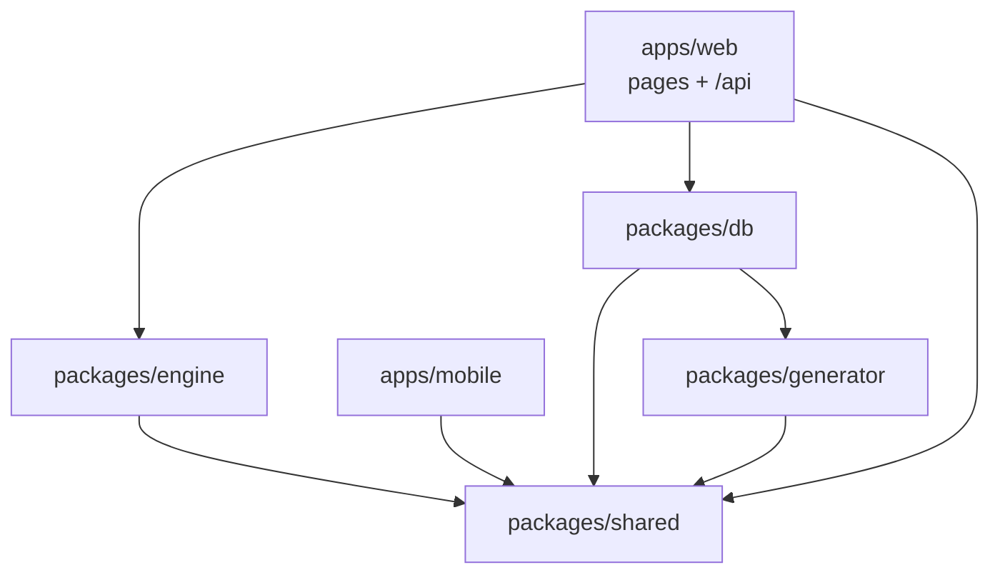
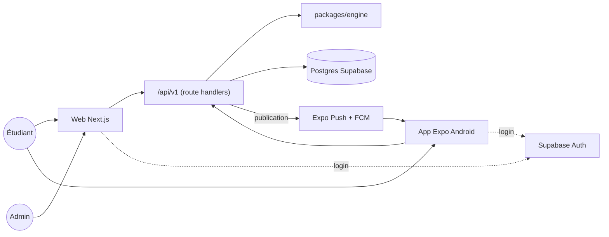
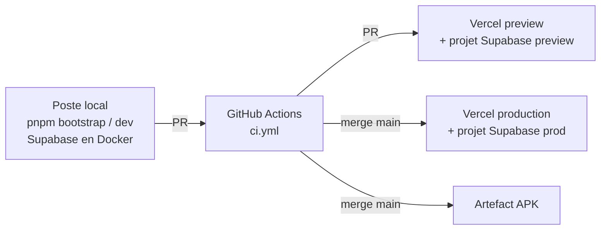
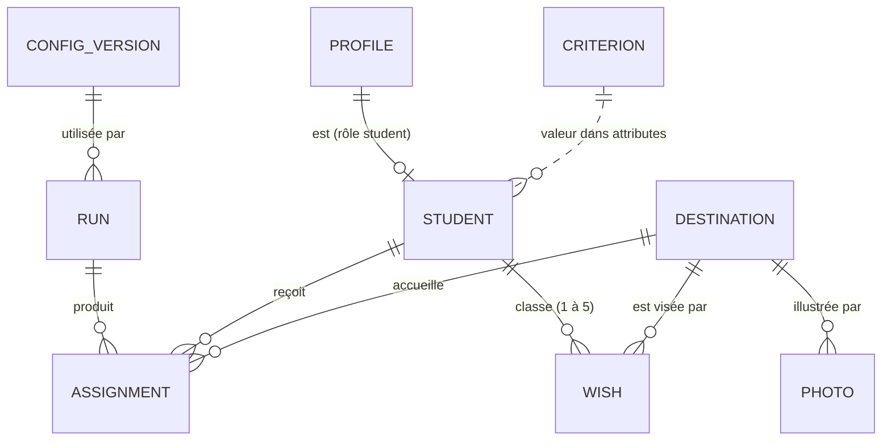

# Architecture — Plateforme de mobilité internationale

Ce document est le **contrat de cohérence** du projet. Il fixe les règles que chaque contribution doit respecter pour que le web, le mobile, l'API et le moteur restent compatibles même s'ils sont développés séparément. Les justifications (contexte, options écartées) sont dans les [ADR](../adr/README.md).

Une règle ne change que par une PR qui modifie ce document **et** ajoute ou remplace un ADR.

## Paradigme

**Cœur fonctionnel, coquille impérative.** Toute la logique métier (règles, scores, algorithmes, statistiques, génération des étudiants) est faite de fonctions pures dans des packages TypeScript. Les applications (`apps/web`, `apps/mobile`) ne sont que des coquilles : elles lisent et écrivent les données, appellent le cœur, puis affichent le résultat.

| Couche | Emplacement | Peut faire des I/O ? |
|---|---|---|
| Contrat | `packages/shared` : schémas Zod, types, constantes, tokens de la charte | Non |
| Cœur | `packages/engine` (règles, algorithmes, explications, métriques), `packages/generator` (étudiants fictifs) | Non |
| Données | `packages/db` : schéma Drizzle, migrations, seed, requêtes | Oui (Postgres) |
| Coquilles | `apps/web` (pages, route handlers `/api`, cas d'usage `server/use-cases`), `apps/mobile` (Expo) | Oui |



Une flèche signifie « peut importer ». Toute autre dépendance est interdite. En particulier, `apps/mobile` n'importe jamais `packages/db` ni `packages/engine`, et aucun package n'importe une app.

## Règles

Chaque règle indique **Binds** (ce qu'elle concerne), **Prevents** (la divergence qu'elle évite) et **Rule** (la contrainte à respecter). `[ADOPTED]` signifie que l'équipe l'a validée.

### AD-1 — Monorepo pnpm + Turborepo, dépendances à sens unique [ADOPTED]

- **Binds :** tout le dépôt
- **Prevents :** du code métier dupliqué entre web et mobile, des dépendances circulaires, un package couplé à une app
- **Rule :** un seul dépôt, des workspaces pnpm (`apps/*`, `packages/*`), des tâches orchestrées par Turborepo. Les imports respectent le graphe ci-dessus. Le code partagé va dans un package, jamais dans une app.

### AD-2 — `packages/shared` est le contrat de l'API [ADOPTED]

- **Binds :** `apps/web/app/api`, `apps/mobile`, `packages/db`
- **Prevents :** un mobile qui consomme une forme de données différente de celle que le web expose ; une documentation d'API qui ne correspond plus au code
- **Rule :** chaque requête et chaque réponse de `/api` a un schéma Zod dans `packages/shared`. Cela inclut le résultat d'affectation et ses explications (union discriminée `Explanation`), ainsi que la liste fermée des codes d'erreur (`ErrorCode`). La route valide l'entrée **et** la sortie avec ce schéma. Les clients web et mobile utilisent les types inférés de ces schémas, et affichent une explication via une seule fonction `formatExplanation` de `packages/shared`. Le fichier OpenAPI est **généré** à partir de ces schémas, jamais écrit à la main.

### AD-3 — Une seule API : les route handlers Next.js [ADOPTED]

- **Binds :** `apps/web`, `apps/mobile`
- **Prevents :** deux backends, des règles métier différentes selon le client
- **Rule :** l'API REST est servie par les route handlers de `apps/web` sous `/api/v1`. Le web et le mobile passent tous les deux par elle pour toute donnée métier. Une route ne contient pas de logique métier : elle authentifie, valide, appelle **un cas d'usage** de `apps/web/server/use-cases/`, puis sérialise. Seuls les cas d'usage orchestrent `packages/db` et `packages/engine` (charger les entrées, appeler le moteur, enregistrer le résultat) ; les pages serveur du web passent par les mêmes cas d'usage que l'API.

### AD-4 — Les clients n'accèdent jamais à la base [ADOPTED]

- **Binds :** `apps/web` (côté navigateur), `apps/mobile`, `packages/db`
- **Prevents :** des permissions dispersées entre client, RLS et serveur ; un étudiant qui lit les données d'un autre
- **Rule :** seul le code serveur, via `packages/db` (Drizzle), lit et écrit dans Postgres. La clé secrète Supabase (`sb_secret_…`) et les URL de connexion ne sortent jamais du serveur ; les clients n'ont que la clé publique (`sb_publishable_…`). Les SDK Supabase côté client servent **uniquement** à l'authentification. RLS est activé sur toutes les tables, sans aucune politique d'accès pour `anon` ni `authenticated`. C'est une deuxième barrière, pas le mécanisme principal.

### AD-5 — Authentification Supabase Auth, autorisation côté serveur [ADOPTED]

- **Binds :** `/api`, `apps/web`, `apps/mobile`
- **Prevents :** un contrôle d'accès oublié sur une route, un identifiant d'utilisateur falsifiable
- **Rule :** l'identité vient de Supabase Auth : cookie de session sur le web (`@supabase/ssr`), jeton `Authorization: Bearer` sur le mobile. Chaque route déclare son rôle requis (`public`, `student`, `admin`) via **un seul helper d'autorisation** partagé. Le jeton est vérifié côté serveur (`getClaims()`), puis le rôle est lu en base (table `profiles`), jamais depuis le client. L'identifiant de l'étudiant vient toujours de la session, jamais du corps ou de l'URL de la requête. L'inscription publique est désactivée : les comptes de démo sont créés par le seed. Les routes qui modifient des données et sont appelées avec un cookie vérifient l'en-tête `Origin` (protection CSRF, en plus de `SameSite=Lax`). Les en-têtes de sécurité (CSP, `X-Content-Type-Options`, `Referrer-Policy`, HSTS) sont définis une seule fois dans la configuration Next.js.

### AD-6 — Le moteur est pur et déterministe [ADOPTED]

- **Binds :** `packages/engine`, `packages/generator`
- **Prevents :** une affectation impossible à rejouer, des tests de stabilité instables, des mesures de performance faussées par des I/O
- **Rule :** aucune I/O, aucune lecture de l'horloge, de variable d'environnement ou du réseau. Le hasard passe uniquement par un générateur pseudo-aléatoire initialisé avec un `seed` explicite reçu en paramètre. Mêmes entrées et même seed donnent un résultat identique, octet pour octet.

### AD-7 — Tous les algorithmes ont la même interface [ADOPTED]

- **Binds :** `packages/engine`, comparatif, mode « et si », statistiques
- **Prevents :** un algorithme qui ne peut pas être comparé aux autres, des statistiques calculées différemment selon l'écran
- **Rule :** un algorithme est une fonction `(entrée d'affectation) → résultat d'affectation`. Les deux formes sont des schémas de `packages/shared` (AD-2). Le résultat contient, pour chaque étudiant, la destination obtenue (ou aucune) **et une explication par vœu mieux classé**, de type `Explanation` : inéligible (critère et seuil), places attribuées à des candidats mieux classés (score du dernier admis), ou destination déjà pleine au tour où le vœu a été examiné (algorithmes non stables). Les performances (temps de calcul pour 1000 étudiants) sont mesurées par un script de benchmark du moteur, lancé à la demande, dont les résultats sont publiés dans `docs/technique/algorithmes.md`. Les métriques du comparatif (% de premiers vœux, % de non-affectés, rang moyen, nombre de paires bloquantes) sont calculées par une seule fonction du moteur, à partir de ce résultat. Gale-Shapley côté étudiants est l'un des algorithmes ; la vérification d'absence de paire bloquante est un test automatique.

### AD-8 — Les configurations sont des données immuables et versionnées [ADOPTED]

- **Binds :** `packages/engine`, `packages/db`, espace administration
- **Prevents :** une affectation passée qui ne peut plus être rejouée, un critère codé en dur
- **Rule :** une configuration (pondérations, seuils éliminatoires, bonus, départages) est un document JSON validé par un schéma Zod de `packages/shared`. Une version enregistrée n'est **jamais modifiée** : l'éditer crée une nouvelle version. Les critères référencent des attributs d'étudiant déclarés dans un **catalogue de critères** en base. Les valeurs sont stockées dans un champ `attributes` JSON. Ajouter un critère revient donc à ajouter une ligne au catalogue, puis des valeurs, **sans modifier de code**. Une exécution enregistre : la version de configuration, l'algorithme, le seed et un **instantané immuable de toute son entrée** (étudiants, attributs, vœux, destinations, places et seuils au moment du lancement), avec son empreinte (hash). Rejouer une exécution, c'est relancer la même fonction pure sur cet instantané ; l'empreinte prouve qu'il n'a pas changé. Le rejeu ne relit jamais les tables vivantes.

### AD-9 — Propriété des données et chemins d'écriture [ADOPTED]

- **Binds :** `/api`, `packages/db`
- **Prevents :** deux modules qui écrivent la même entité de deux façons différentes
- **Rule :** chaque entité a un seul chemin d'écriture, qui passe par `/api`, sauf le seed (voir le tableau). Le serveur est la seule source de vérité : le mobile peut **lire** hors connexion, mais toute écriture (dont les vœux) se fait en ligne.

| Entité | Écrite par | Via |
|---|---|---|
| Destinations, étudiants fictifs, vœux initiaux, comptes et profils de démo | Seed uniquement | `packages/db` seed (depuis `data/` et `packages/generator`) |
| Vœux (5 maximum, ordonnés, destinations distinctes) | L'étudiant concerné, campagne `open` | `PUT /api/v1/me/wishes` (remplace la liste entière, en-tête `If-Match` sur la version courante, sinon `409`) |
| Catalogue de critères, valeurs de critère des étudiants, versions de configuration | Administrateur | `/api/v1/admin/...` |
| Campagne et son état | Administrateur | `/api/v1/admin/campaign` (AD-16) |
| Exécution d'affectation, instantané et résultat | Administrateur, via le moteur | `/api/v1/admin/runs` |
| Publication des résultats | Administrateur | `/api/v1/admin/runs/{id}/publish` (AD-16, déclenche la notification mobile) |
| Jetons de notification de l'appareil | L'étudiant concerné | `PUT /api/v1/me/push-tokens` |

### AD-10 — Les données réelles sont sourcées dans `data/` [ADOPTED]

- **Binds :** `data/`, `packages/db` seed, fiches université
- **Prevents :** une donnée réelle sans source, une photo sans licence, une donnée inventée présentée comme réelle
- **Rule :** `data/` est la seule source des données réelles (universités, coût de la vie, photos). Chaque valeur réelle porte une URL de source ; chaque photo porte son auteur, sa licence et son texte alternatif. Une valeur incertaine vaut `null` et le doute est expliqué dans `notes`. Les attributs fictifs (places, seuils) restent cohérents avec la sélectivité de l'université. Le seed lit `data/` ; la base n'est jamais modifiée à la main. Le seed échoue si les 6 continents habités ne sont pas tous couverts. Le web et le mobile affichent sur chaque écran la mention « Projet pédagogique : partenariats fictifs » (composant de mise en page commun, pas page par page).

### AD-11 — Accessibilité WCAG 2.2 AA vérifiée en continu [ADOPTED]

- **Binds :** `apps/web`, `apps/mobile`, `packages/shared` (tokens)
- **Prevents :** des régressions d'accessibilité découvertes seulement à l'audit final
- **Rule :** les couleurs et typographies viennent exclusivement des tokens de la charte dans `packages/shared` : aucune couleur codée en dur. Chaque couple texte/fond des tokens respecte un contraste de 4,5:1. Les règles a11y de Biome sont actives (elles ne couvrent que le web). Chaque page web a un test Playwright + axe dans la CI, qui échoue sur toute violation `serious` ou `critical`. Sur mobile, les tests d'interface interrogent les écrans par rôle et par libellé accessibles. Toute vue carte a une vue liste équivalente, avec les mêmes données et les mêmes filtres. Les tests automatiques ne remplacent pas l'audit manuel (clavier, NVDA, TalkBack) ni la déclaration d'accessibilité publiée sur la plateforme, qui restent des livrables (#31 à #33).

### AD-12 — Tout passe par la CI, les secrets restent dans GitHub [ADOPTED]

- **Binds :** `.github/workflows`, Vercel, Supabase, APK
- **Prevents :** un déploiement fait à la main depuis un poste, un secret dans le dépôt, un `main` cassé
- **Rule :** `main` est protégée : on y entre uniquement par une PR en squash merge, dont la vérification `ci` est verte. L'auteur de la PR en est responsable ; l'approbation n'est pas obligatoire (décision d'équipe, voir ADR-0009). La vérification `ci` d'une PR exécute le lint, la vérification des types, les tests du web **et du mobile**, le build web et l'export du bundle mobile. Le web est déployé uniquement par GitHub Actions avec la CLI Vercel : preview sur chaque PR, production à chaque merge. Cela suppose que le dépôt reste **public**, car l'offre Hobby bloque les déploiements de commits d'autres auteurs sur un dépôt privé. L'APK est construit à chaque merge et publié en artefact. Il n'existe **qu'un seul historique de migrations** (drizzle-kit, dans `packages/db`), appliqué par la CI avant chaque déploiement. La base preview est réinitialisée (migrations + seed) à chaque déploiement de preview. La CI se connecte à Postgres par le pooler en mode session (`DATABASE_URL_MIGRATIONS`), et le runtime Vercel par le pooler en mode transaction (`DATABASE_URL`, `prepare: false`). Les secrets sont dans les secrets GitHub ; en local, dans `.env` (non versionné), documenté par `.env.example`. Le compte Vercel est dédié au projet et ses identifiants sont dans un gestionnaire de mots de passe partagé. L'organisation Supabase est dédiée et a deux membres nominatifs.

### AD-13 — Une commande pour installer, une pour lancer, une pour tester [ADOPTED]

- **Binds :** `package.json` racine, `scripts/`, README
- **Prevents :** un nouvel arrivant bloqué, des procédures différentes selon les postes
- **Rule :** `pnpm bootstrap` vérifie les prérequis (Node ≥ 24.3, pnpm, Docker), installe les dépendances, installe BMad (AD-14 ; étape ignorée en CI ou avec `SKIP_BMAD=1`, pour qu'un relecteur extérieur sans Claude Code reste sous les 15 minutes), démarre Supabase en local, applique les migrations, charge les données de démo et crée `.env` à partir de `.env.example`. `pnpm dev` lance la plateforme. `pnpm test` lance tous les tests du dépôt. Toute nouvelle étape d'installation s'ajoute à `pnpm bootstrap`, jamais seulement dans le README.

### AD-14 — BMad est installé à l'identique chez chaque membre [ADOPTED]

- **Binds :** tous les contributeurs, `scripts/setup-bmad.sh`, `.claude/skills/`
- **Prevents :** des agents IA qui n'ont pas les mêmes skills ni les mêmes versions selon le poste
- **Rule :** BMad est obligatoire. Il s'installe avec `scripts/setup-bmad.sh` (appelé par `pnpm bootstrap`), qui fixe la version de BMad, ses modules, l'outil (`claude-code`) et la langue (français). `_bmad/`, `_bmad-output/` et les skills générés ne sont pas versionnés. Seuls les skills propres au projet le sont (par exemple `.claude/skills/mobility-help`). Tout usage de l'IA est déclaré dans la section dédiée du README.

### AD-15 — Une seule définition de l'éligibilité, du score et de l'ordre [ADOPTED]

- **Binds :** `packages/engine`, `packages/generator`, `packages/db` (instantanés)
- **Prevents :** deux algorithmes qui calculent le score différemment ; un rejeu qui donne un autre résultat parce que l'ordre des lignes ou les uuid ont changé
- **Rule :** le moteur expose **une seule** fonction `eligibility(étudiant, destination, config)` et **une seule** fonction `score(étudiant, destination, config)`, que tous les algorithmes utilisent. Les seuils d'accès propres à une destination (GPA minimum, niveau d'anglais minimum, places) viennent de la destination. La configuration porte les pondérations, les seuils éliminatoires globaux, les bonus et les départages. Les scores d'anglais TOEIC et IELTS sont convertis vers une seule échelle (niveau CECRL) par une seule fonction du moteur. L'entrée est triée sur des identifiants stables : `slug` pour les destinations, identifiant externe issu du générateur pour les étudiants (jamais un uuid de base). Le dernier départage, en cas d'égalité totale, utilise le générateur pseudo-aléatoire seedé.

### AD-16 — Le cycle de vie de la campagne est appliqué par le serveur [ADOPTED]

- **Binds :** `/api`, `apps/web`, `apps/mobile`, `packages/db`
- **Prevents :** un web qui bloque les vœux pendant que le mobile les accepte encore ; deux résultats publiés en même temps
- **Rule :** il y a une seule campagne active. Son état suit `draft → open → closed → published` et ne fait qu'avancer. Les vœux ne sont modifiables qu'à l'état `open` ; sinon, l'API répond `409` avec le code `WISHES_CLOSED`. Les exécutions (simulations, comparaisons « et si ») sont possibles à tout moment, mais **une seule exécution est publiée**, à l'état `closed`. La publication fait passer la campagne à `published`, est irréversible, et c'est le seul événement qui déclenche la notification. Les clients lisent l'état de la campagne dans l'API ; ils ne le calculent jamais à partir d'une date.

## Conventions

| Sujet | Convention |
|---|---|
| Langue | Code et identifiants en anglais. Interface, documentation, issues, PR et messages de commit en français |
| Nommage | Fichiers en `kebab-case`. Composants React en `PascalCase`. Tables et colonnes Postgres en `snake_case` (mapping `casing: 'snake_case'` de Drizzle). TypeScript en `camelCase` |
| Identifiants | `uuid` générés par Postgres. Les destinations gardent en plus leur `slug` unique, issu de `data/` |
| Dates | ISO 8601 en UTC dans l'API et en base (`timestamptz`) |
| API | REST JSON sous `/api/v1`, ressources au pluriel en `kebab-case`, `/me/...` pour les données de l'utilisateur connecté |
| Erreurs d'API | Toujours `{ "error": { "code": "WISH_LIMIT_EXCEEDED", "message": "…", "details"?: … } }`, avec le statut HTTP adapté. `message` est lisible par un humain, en français |
| Validation | Zod aux frontières : entrées et sorties de l'API, variables d'environnement (validées au démarrage), fichiers de configuration |
| Logs | Un logger structuré unique côté serveur. Jamais de données personnelles, de jeton ni de mot de passe dans les logs. Logs lisibles en développement |
| Commits | Conventional Commits, scopes : `web`, `mobile`, `engine`, `api`, `db`, `shared`, `data`, `docs`, `ci`. Vérifiés par commitlint (Lefthook) |
| Branches et PR | `<type>/<N>-<slug>` (ex. `feat/17-gale-shapley`). Une PR par issue, reliée par `Closes #N`. Titre de PR conventionnel (il devient le commit du squash) |
| Lint et format | Biome pour tout le dépôt (`biome.json` racine), appliqué avant chaque commit et dans la CI |
| Versions | release-please avec une version unique pour le dépôt : `CHANGELOG.md` et tags `vX.Y.Z` aux étapes clés |
| Décisions | Toute décision structurante = un ADR dans `docs/adr/` |

## Stack

Versions courantes relevées le 2026-11-24. Le scaffold (#2) les fige dans le lockfile.

| Nom | Version |
|---|---|
| Node.js | 24 LTS (≥ 24.3, exigé par Expo) |
| pnpm | 12.23 |
| Turborepo | 2.11 |
| TypeScript | 6.0 (TS 7.0 n'expose pas encore d'API de compilation JS ; réévaluer à la 7.1) |
| Next.js (App Router) | 16.4 |
| React | 19.3 |
| Tailwind CSS (web) | 4.3 |
| Zod | 4.6 |
| Drizzle ORM / drizzle-kit | 0.45 / 0.31 |
| Supabase (Postgres + Auth), CLI | offre Free, CLI 3.4 |
| @supabase/supabase-js / @supabase/ssr | 2.119 / 0.12 |
| Expo SDK + Expo Router (Android) | 58 |
| Biome | 2.6 |
| Lefthook | 2.2 |
| commitlint | 21.2 |
| Vitest | 5.1 |
| Playwright + @axe-core/playwright | 1.65 / 4.14 |
| release-please | 17.11 |
| BMad Method (modules bmm, tea, cis) | 6.12.2 (figé volontairement ; montée de version = PR sur `scripts/setup-bmad.sh`) |
| Hébergement web | Vercel (Hobby, compte dédié) |
| CI/CD | GitHub Actions |

## Structure de départ

```text
mobility-platform/
  apps/
    web/            # Next.js : pages étudiant/admin, route handlers /api/v1,
                    #   server/use-cases/ (orchestration db + moteur)
    mobile/         # Expo Android : espace étudiant (voir son README)
  packages/
    shared/         # schémas Zod (contrat d'API), types, tokens de la charte
    engine/         # règles, scores, algorithmes, explications, métriques (pur)
    generator/      # générateur seedé des 1000 étudiants fictifs (pur)
    db/             # schéma Drizzle, migrations, seed, requêtes
  data/             # données réelles sourcées (universités, photos, coût de la vie)
  docs/
    adr/            # journal des décisions (ADR)
    guide/          # documentation utilisateur et guides de contribution
    technique/      # architecture, API, moteur, exploitation
  scripts/          # bootstrap, setup-bmad, task.sh (suivi des tâches)
  supabase/         # config de la stack Supabase locale
  .github/          # workflows, modèles d'issue et de PR, dependabot
  .claude/skills/mobility-help/   # commande d'aide du projet (versionnée)
```

### Composants et flux



### Environnements et déploiement



| Environnement | Web | Base et auth | Données |
|---|---|---|---|
| Local | `pnpm dev` | Supabase CLI (Docker) | seed de démo automatique |
| Preview (chaque PR) | Vercel preview | projet Supabase `preview` | seed de démo |
| Production (`main`) | Vercel production | projet Supabase `prod` | seed de démo |

Les migrations sont appliquées par la CI avant le déploiement (AD-12). L'offre Free de Supabase compte deux projets actifs **par propriétaire ou administrateur, toutes organisations confondues** : Alexandre est propriétaire des deux projets, Ethan a le rôle Developer.

Secrets GitHub attendus : `VERCEL_TOKEN`, `VERCEL_ORG_ID`, `VERCEL_PROJECT_ID`, `DATABASE_URL` et `DATABASE_URL_MIGRATIONS` (preview et prod), `SUPABASE_URL`, `SUPABASE_PUBLISHABLE_KEY`, `SUPABASE_SECRET_KEY`, et, si Ethan retient le push distant, `EXPO_ACCESS_TOKEN` et les identifiants FCM V1.

### Entités principales



## Correspondance sujet → architecture

| Exigence du sujet | Où | Règle |
|---|---|---|
| Catalogue, fiches, carte + vue liste | `apps/web`, `apps/mobile` | AD-2, AD-3, AD-11 |
| Saisie des 5 vœux, synchronisation web/mobile | `/api/v1/me/wishes` | AD-3, AD-9 |
| Règles configurables, ajout de critère sans code, rejeu | `packages/engine`, `packages/db` | AD-6, AD-8, AD-15 |
| Au moins 2 algorithmes dont Gale-Shapley, comparatif chiffré, mode « et si », performances mesurées | `packages/engine` | AD-7, AD-15 |
| Saisie des vœux puis publication des résultats | `/api`, web, mobile | AD-16 |
| Mention « Projet pédagogique : partenariats fictifs », couverture des 6 continents | web, mobile, seed | AD-10 |
| Résultat avec explication | `packages/engine` → `/api` | AD-7 |
| 100 destinations sourcées, photos sous licence | `data/` | AD-10 |
| 1000 étudiants reproductibles | `packages/generator` | AD-6 |
| Comptes distincts, OWASP (dont CSRF, en-têtes), permissions côté serveur | `/api`, Supabase Auth | AD-4, AD-5 |
| Mobile natif Android, hors connexion, notification | `apps/mobile` | AD-3, AD-9, AD-12 |
| WCAG 2.2 AA | web, mobile, tokens | AD-11 |
| CI bloquante, CD web, APK en artefact, secrets | `.github/workflows` | AD-12 |
| Nouvel arrivant en moins de 15 minutes | `pnpm bootstrap` | AD-13 |
| Usage de l'IA encadré et déclaré | README, BMad | AD-14 |

## Reporté

| Sujet | Pourquoi ça peut attendre |
|---|---|
| Choix internes au mobile (build APK, librairie de styles, cache hors connexion, notification, navigation, carte, stockage du jeton, outils de test) | Décidés par Ethan dans des ADR (voir `apps/mobile/README.md`), dans le cadre des règles AD-2 à AD-5, AD-9, AD-11 et AD-12 |
| Second algorithme (glouton par score, Boston…) | Choisi dans #23 ; l'interface est déjà fixée par AD-7 |
| Format détaillé d'une configuration et des critères | Défini dans #21 et documenté dans `docs/technique/moteur.md` ; le principe est fixé par AD-8 |
| Librairie de cartographie web | Choisie dans #27 ; contrainte par AD-11 (points au clavier, vue liste) |
| Générateur OpenAPI exact (`zod-openapi` ou `@asteasolutions/zod-to-openapi`) | Choisi dans #14 ; la génération à partir de Zod est fixée par AD-2 |
| Librairie de logs | Choisie au scaffold (#2) ; la convention de logs est fixée |
| Compatibilité TypeScript 7 | Le scaffold (#2) vérifie que `next build` échoue sur une erreur de type et que `tsc --noEmit` passe dans `apps/mobile` avant toute montée de version |
| Déploiement Vercel d'un commit d'Ethan (avec trailer de co-auteur) | Testé dans #2 ; repli : `vercel deploy --prebuilt` depuis un dossier sans `.git` |
| Format précis de l'instantané d'entrée et du résultat | Défini dans #21 et #22, dans le cadre d'AD-8 et AD-15 |
| Mise en veille des projets Supabase Free après inactivité | À traiter avant le follow-up de décembre (tâche planifiée de maintien ou réveil avant la démo) |
| Devcontainer | Seulement si le test du nouvel arrivant (#36) échoue avec `pnpm bootstrap` |
| Internationalisation de l'interface | Hors sujet : interface en français uniquement |
| Monitoring et alertes en production | Hors périmètre d'un projet pédagogique ; les logs Vercel suffisent |
